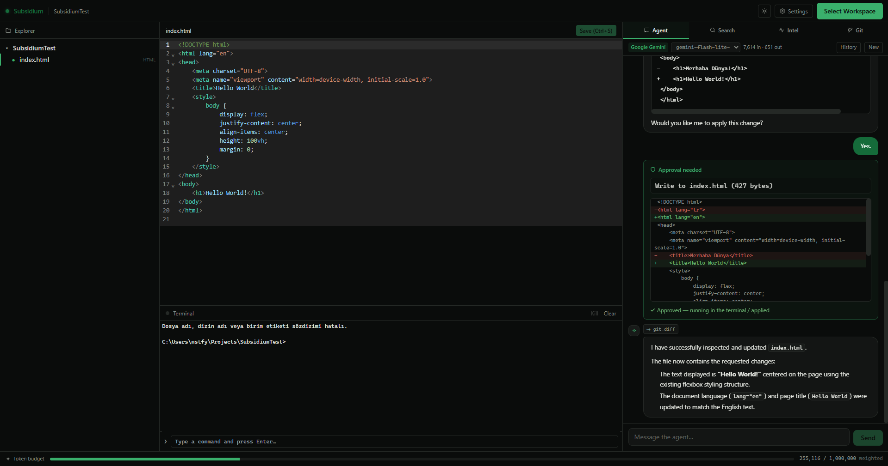

<div align="center">

<h1>
  <span style="color:#174A3A;">◈ Subsidium</span>
</h1>

<p>
  A local workspace-intelligence coding agent for your projects.
</p>

<br>



</div>

<br>

## Overview

Subsidium is a desktop coding environment built around your workspace.

It brings the file explorer, code editor, terminal, search, Git information and an agent into one place. The agent can inspect your project, search through files, read code and perform actions when you allow it.

Built with **Tauri, Rust and React**.

---

## How It Works

Subsidium is built around a simple workflow:

```text
Choose a workspace
       ↓
Explore the project
       ↓
Ask the agent
       ↓
Inspect what it wants to do
       ↓
Approve when needed
       ↓
Continue working
```

The workspace is the center of everything.

When a folder is opened, Subsidium discovers its files, indexes supported source code and connects the editor, terminal, search and agent to that workspace.

---

## Interface

### Explorer

Browse the current workspace through a familiar file tree.

* Folder and file navigation
* Collapsible directories
* Open files directly in the editor
* Workspace selection
* `.gitignore` aware file discovery

### Editor

A CodeMirror-based editor for working directly on your files.

Supported syntax includes:

* JavaScript / TypeScript
* Python
* Rust
* CSS
* HTML
* JSON
* Markdown

Changes are saved to disk and the workspace index is updated accordingly.

### Terminal

A real interactive terminal runs alongside the editor.

On Windows, Subsidium uses a PTY-backed `cmd.exe` session rooted in the selected workspace.

It supports:

* Interactive commands
* Live output
* Running development servers
* Process termination
* Clearing the terminal
* Commands initiated by the agent

### Agent

The agent is the main interaction layer.

It can inspect the workspace through tools such as:

```text
search_code
read_file
git_status
git_diff
```

Actions that can modify the workspace require approval:

```text
write_file
run_command
```

Before a file is changed, Subsidium shows the proposed change for review.

Before a command is executed, you can approve or deny it.

You remain in control of changes made to the workspace.

### Search

Search across the workspace for:

* File names
* Symbols
* Full-text matches

The current implementation exposes raw search results. Later versions will use the same index as part of the agent's context.

### Intel

A quick overview of the current workspace.

Currently available:

* File count
* Language breakdown
* Index information

Project-level summaries are planned for a later phase.

### Git

Git information directly inside the workspace.

Currently available:

```text
git status
git diff
```

Git operations such as committing and pushing are outside the current scope.

---

## Workspace Index

When a workspace is opened, Subsidium builds an index of the project.

```text
Workspace
   │
   ├── File discovery
   │      └── .gitignore rules
   │
   ├── Source parsing
   │      └── Tree-sitter
   │
   ├── Metadata
   │
   └── SQLite index
```

Supported source files are parsed structurally where possible rather than being treated only as plain text.

This provides the foundation for faster search and deeper workspace understanding in later versions.

---

## Agent Architecture

The agent communicates with a configured model through a provider abstraction.

Supported providers include:

* Anthropic
* Gemini
* OpenAI-compatible APIs
* Ollama

The model does not directly receive the entire workspace.

Instead, it interacts with the project through tools.

### Read-only tools

These can run without confirmation:

```text
search_code
read_file
git_status
git_diff
```

### Privileged tools

These require explicit approval:

```text
write_file
run_command
```

A typical interaction looks like:

```text
User
 │
 ▼
Agent
 │
 ├── search_code
 │
 ├── read_file
 │
 ├── git_diff
 │
 └── write_file ──► Approval
                       │
                  Approve / Deny
                       │
                       ▼
                    Workspace
```

The distinction between reading and modifying the workspace is intentional.

---

## Conversations

Conversations are stored locally using SQLite.

You can:

* Start a new conversation
* Continue previous conversations
* Load conversation history
* Reset the current workspace conversation

Changing the workspace starts a fresh conversation context.

---

## Settings

### Providers

Configure:

* Provider
* API key
* Model
* Base URL where applicable
* Active provider

API keys are stored using the operating system's secure keyring.

### Application

Configure:

* Token budget
* Usage counter
* Theme

---

## Tech Stack

### Desktop

* Tauri
* Rust

### Frontend

* React
* TypeScript
* CodeMirror

### Workspace

* Tree-sitter
* SQLite
* Git

### Terminal

* portable-pty

### Providers

* Anthropic
* Gemini
* OpenAI-compatible APIs
* Ollama

---

## Project Status

Subsidium is currently in **Phase 1**.

The core desktop environment and agent loop are working, but the project is still under active development.

### Working

* [x] Workspace selection
* [x] File explorer
* [x] Code editor
* [x] Syntax highlighting
* [x] Workspace indexing
* [x] Tree-sitter parsing
* [x] SQLite index
* [x] Workspace search
* [x] Interactive terminal
* [x] Agent chat
* [x] Read-only agent tools
* [x] Privileged tool approval
* [x] File write approval
* [x] File diffs
* [x] Git status
* [x] Git diff
* [x] Conversation history
* [x] Multiple AI providers
* [x] Secure API key storage
* [x] Dark / light themes

### Planned

* [ ] Background file watching
* [ ] Automatic re-indexing
* [ ] Project summaries
* [ ] Improved diff review
* [ ] Persistent agent memory
* [ ] Multiple workspaces
* [ ] More Tree-sitter languages
* [ ] Deeper code intelligence
* [ ] Improved agent workflows

---

## Development

Clone the repository:

```bash
git clone https://github.com/fraisensenpai/Subsidium.git
cd Subsidium
```

Install dependencies:

```bash
npm install
```

Start the development application:

```bash
npm run tauri dev
```

---

## Philosophy

**The workspace comes first.**

The agent should understand the project it is working in instead of treating every request as an isolated prompt.

**Actions should be visible.**

Reading a project and changing a project are different things. Changes and commands should not happen silently.

**Local-first.**

The application, workspace index, conversations and terminal live on your machine. The model provider is configurable.

**Build the environment, not just the chat.**

The goal is not another chat window with a code editor attached to it. The goal is a single environment where the project, tools and agent can work together.

---

## Roadmap

Subsidium is being developed incrementally.

```text
Phase 1
Workspace + Editor + Terminal + Agent
        │
        ▼
Phase 2
Deeper Workspace Intelligence
        │
        ▼
Phase 3
Context & Retrieval
        │
        ▼
Phase 4
Agent Improvements
        │
        ▼
Phase 5
Production Hardening
```

The architecture is being built so later capabilities can be added without replacing the core workspace layer.

---

## License

See [LICENSE](LICENSE).

<br>

<div align="center">

**Subsidium**

Built with Rust, React and a lot of iteration.

</div>
